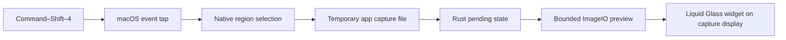
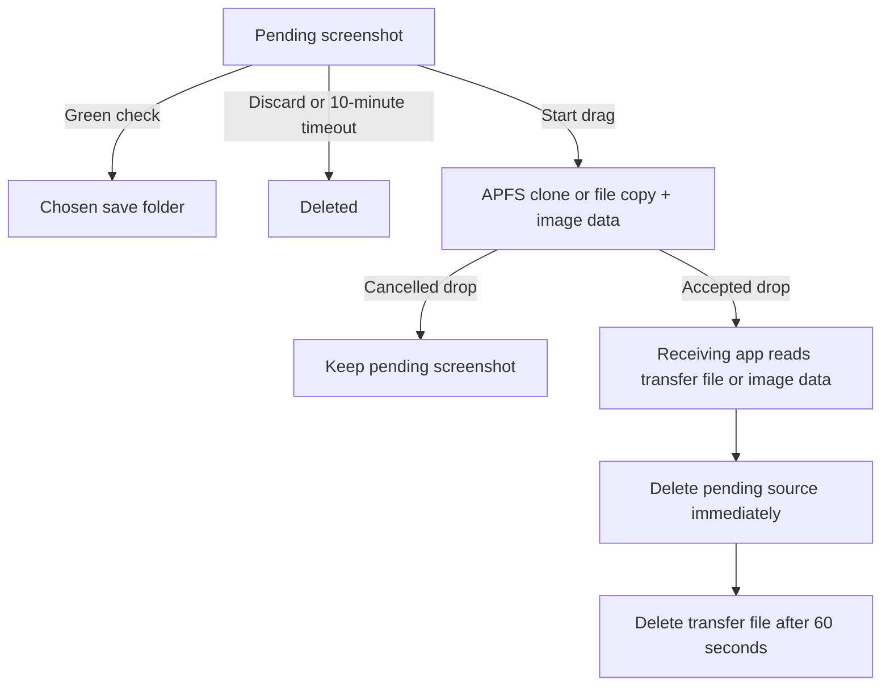

# Screenshot Shelf

Take a screenshot with **Command–Shift–4**. A native Liquid Glass widget holds it on the display where you captured it. Drag it into another app, press the large green check to keep it, or press × to delete it.

## Install from Terminal — no Rust or build tools needed

Requires **Apple silicon and macOS 26 or newer**. Open Terminal, paste this command, then press Return:

```sh
/usr/bin/curl -fsSL https://raw.githubusercontent.com/SamarthaB10/MacOS-screenshot-shelf/main/scripts/install-latest.sh | /bin/bash
```

The installer downloads the latest successful macOS build, puts **Screenshot Shelf.app** in `~/Applications`, opens it, and starts the permission prompts. It does not install Rust or build the app. It needs an internet connection, but no GitHub account. If there is no available build, ask the app owner to run **Build macOS app** from [GitHub Actions](https://github.com/SamarthaB10/MacOS-screenshot-shelf/actions/workflows/build.yml).

### Allow screenshot access

1. When macOS asks, open **System Settings** and allow **Screenshot Shelf** under **Privacy & Security → Accessibility**.
2. Also allow it under **Privacy & Security → Screen & System Audio Recording**. The name can differ on older macOS versions.
3. If macOS asks you to quit and reopen the app, do that. The menu-bar menu shows **Fast capture ready** when setup is complete.
4. Press **Command–Shift–4** and select a region. The widget appears when capture completes.

If the permission prompts do not appear, open the menu-bar icon and select **Enable fast capture…**. The app needs both permissions to intercept the shortcut and capture the screen.

This build is ad-hoc signed and is not notarized by Apple. If macOS blocks the first open, follow [Apple's steps to open an app you trust](https://support.apple.com/102445).

Use the menu-bar icon to choose a save folder. By default, saved images go to `~/Pictures/Screenshot Shelf/Saved`.

The app intercepts Command–Shift–4 only while it is running and has the required permissions. Other macOS screenshot shortcuts keep their normal behavior. You can also use **Take screenshot** from the menu. The widget starts on the capture display and can be moved by dragging its background.

The menu shows **Fast capture ready** when the shortcut is active. If fast capture is not enabled, choose **Enable fast capture…** from the menu. After fast capture is enabled, the app also watches the configured macOS screenshot folder for other file-based screenshot shortcuts. It does not silently use that slower path while permissions are missing. That fallback can be delayed by the macOS floating thumbnail; direct capture bypasses it. Clipboard-only screenshots are not imported.

## Use

- **Drag:** drop the selected image into the receiving app's image or file input. An accepted drop removes it from the widget and deletes its pending source. A cancelled or rejected drop keeps it.
- **Green check:** save the selected image to the chosen folder. A failed save keeps it and shows an error. Existing saved files are not overwritten.
- **×:** delete only the selected image.
- **Arrows:** select another waiting screenshot.
- **10 minutes without action:** delete all pending images and close the widget. New captures and widget actions restart this timer. An active drag is protected from timeout deletion.

There is no recovery archive. Browser drops use a separate transfer file for **60 seconds**, so the browser can read the image after the pending source is deleted. The transfer file has no recovery UI and is then deleted. A receiving app that waits longer than 60 seconds can still fail. Cleanup stops while the app is closed; expired files are removed on the next launch.

Saved screenshots are never part of timeout cleanup. Use **Start at login** from the menu after placing the app in Applications.

## How it works

Rust owns the pending-image list, selected image, save operations, and idle deadline. A small Objective-C adapter calls AppKit, ImageIO, Dispatch, and macOS capture APIs. There is no webview and no third-party runtime package.



The event tap detects the shortcut, not an image file. It starts `/usr/sbin/screencapture -i -x -t png` with a temporary output path. Process completion calls Rust directly. The primary flow does not wait for a Desktop file or a folder watcher. A 600-pixel preview keeps the widget from decoding the full image for display.



Files live under `~/Library/Application Support/Screenshot Shelf/`: `Capture` holds direct-capture output until Rust takes it, `Pending` holds waiting images, and `Transfer` holds short-lived drop files. The selected save folder is separate. The widget chooses a display from screenshot rectangle metadata, with the pointer display as a fallback.

## Build from source

Install Rust and Apple's command-line tools with a macOS 26 SDK, then run:

```sh
./scripts/build-app.sh
open "dist/Screenshot Shelf.app"
```

The build creates the app and `dist/Screenshot-Shelf-macos-arm64.zip`. The archive is signed and verified before it is copied into a synced folder.

```sh
cargo fmt --check
MACOSX_DEPLOYMENT_TARGET=26.0 cargo check
cargo clippy --all-targets -- -D warnings
./scripts/build-app.sh
```

For folder diagnostics:

```sh
"dist/Screenshot Shelf.app/Contents/MacOS/Screenshot Shelf" --status
```

No unit or integration tests are included, as requested. See [requirements](docs/REQUIREMENTS.md), [verification](docs/VERIFICATION.md), and [design decisions](docs/adr/).

## Keep it running and keep permissions

Keep one installed copy in **Applications**. Select **Start at login** from the menu. The app stays in the menu bar when the widget is empty. It does not need an open widget to capture.

The app no longer asks for permissions on every launch. Use **Enable fast capture…** only when needed. Moving the app or installing a different ad-hoc development build can cause macOS to request access again. A build signed with the same Apple signing identity has a stable code identity. If you have a signing certificate, build with:

```sh
SHELF_SIGNING_IDENTITY='Your Apple signing identity' ./scripts/build-app.sh
```

GitHub builds use an ad-hoc signature unless a release signing service is configured. A Developer ID signature and notarization are needed for normal public distribution.
